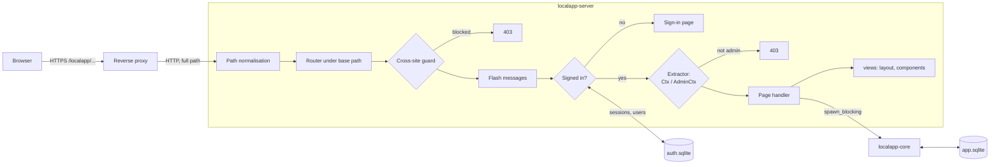

# Hockey Practice Planner

[](https://github.com/njneeteson/rs-hockeypractice/actions/workflows/ci.yml)
[](https://github.com/njneeteson/rs-hockeypractice/actions/workflows/tests.yml)
[](https://codecov.io/gh/njneeteson/rs-hockeypractice)

A self-hosted web app for planning hockey practices. Coaches keep libraries
of drills, each drawn on a rink diagram, then build a practice by dropping
drills onto the ice. Coaches in the same team plan together. The finished plan downloads as a PDF with one
page per part of the practice.

Built on the LocalApp template: a Rust core library, an
[axum](https://github.com/tokio-rs/axum) server that renders HTML with
[maud](https://maud.lambda.xyz), and [htmx](https://htmx.org). Data lives in
SQLite. It ships as one binary (all assets and fonts compiled in, nothing
loaded from a CDN) inside a distroless Docker image, meant to sit behind your
reverse proxy at a path such as `https://miniserver.local/localapp`.

## Contents

- [Planning practices](#planning-practices)
- [Starting a new project](#starting-a-new-project)
- [What's included](#whats-included)
- [Layout](#layout)
- [Development](#development)
- [Configuration](#configuration)
- [Building the app](#building-the-app)
- [Security](#security)
- [Deploying](#deploying)

## Planning practices

Each person sees only their own drills and the teams they belong to.

- **Teams** (`/teams`): the team name is printed in the footer of each page.
  Whoever creates a team is its **owner**; owners add other coaches (by
  username), make them owners or coaches, and take them out. Every member
  plans the team's practices and edits the team's drills. A team always has
  an owner: the last one can't leave or step down.
- **Drill libraries** (`/drills`): your own (only you see it) and one per
  team (shared by its members); switch between them at the top of the page.
  **Copy to…** on a drill copies it into another of your libraries. A copy
  is separate: changing one never changes the other, so nobody can change
  your drills, and you can't change theirs. A practice uses only its team's
  drills: placing one of your own copies it into the team's library first
  (once; placing it again reuses that copy). Each drill has a name, category, suggested
  minutes, the **ice it needs**, how to run it, key teaching points (one per
  line) and equipment with quantities. Its diagram is drawn in the browser:
  players (X, O, F, D or any label; coaches C and goalies G are circled),
  nets, cones, pucks, puck piles, tires, barriers, danglers and text. Nets,
  barriers and danglers can be turned to any angle (drag the round handle, or
  R / Shift+R), and a net dropped near a goal line snaps onto it; the rink
  itself has no nets. Lines follow the usual drill-sheet symbols: skate (solid),
  skate with the puck (wavy), pass (dashed), shot (double), skate backward
  (cups), backward with the puck (cups and dots), lateral steps (ticks),
  crossovers (X's), goalie pad slide and butterfly slide, ending in an arrow,
  a stop (two bars) or nothing. *Add example drills* on an empty library adds
  a drill for each main area, a lane drill and a goalie drill.
- **Development model** (`/development`): Hockey Canada's skill development
  pyramid, with five levels: technical skills, individual tactics, team
  tactics, team play and strategy. Every drill says how its time splits
  across them (5% steps, adding to 100%; required when saving). A team has an
  age division (U7 to U18) with Hockey Canada's targets for each level, which
  an owner can replace with the team's own. The practice builder shows the
  practice's split per player against the targets, live; the team page adds
  up the season. Per player, a part's minutes are shared equally by its
  drills (rotating through stations, or one station per group, average out
  the same).
- **Practices** (`/practices`): a date, optional start time, a team, and full
  or half ice. A practice is a list of **parts**. Each part has a length, a
  title, an **ice layout**, an optional rotation time and notes. The builder
  shows each part's rink with a legend beside it. Drag a drill from the
  library onto a station it fits, click a drill and then a station, or pick
  one from the station's list (it is placed as soon as it's picked). Changes
  update the part in place without reloading the page or losing your place;
  without JavaScript the same forms post and come back to the part. Each part
  can have a **goalie warm-up** (two nets with goalies and a coach shooting)
  at a corner or neutral-zone spot; drag it on the rink to put it anywhere
  out of the drills' way, and turn it with ⟲ ⟳. *Preview the printed page*
  shows that part's PDF page. Parts can be reordered and copied, and a whole
  practice can be copied to a new date.
- **PDF** (*Download PDF*): one US Letter page per part, never more, so the
  bench can follow one sheet. A one-line header has the date, clock time (or
  elapsed time), part title and length; the rink diagram with a **legend** to
  its right listing every symbol on that rink; a strip with the layout,
  rotation, goalie warm-up, equipment and notes; then one block per drill,
  full width and never split: a title bar with the number, name and details on
  the left and the key points on the right, and the description below it. A
  one-line footer has the team, practice title and page number. When the text
  is long the diagram gets smaller, then the text (down to 5.5 pt); only if it
  still doesn't fit is it cut short, with a note.

For a walkthrough with screenshots, written for coaches using the app, see the
**[user guide](docs/user-guide.md)**.

### Ice sizes and layouts

The rink is a North American 200 × 85 ft sheet. A drill needs an **area**, at
full width or as one of 2–4 **lanes** running along it. It is drawn on the
area at the left of the rink (its top lane when split), and the builder moves
it (shifted, mirrored or turned) onto a station. A drill fits any station its
shape fits inside, at the same place on the rink: a lane drill in a wider lane
or the whole area, an end-zone drill (or end-zone lane) on half ice or a lane
of it, a half-ice drill in a full-ice lane. A smaller drill sits against the
boards side of its station. Lanes in
the bottom half are mirrored so a drill along the boards stays on the boards;
**Flip top/bottom** on a placed drill turns it over inside its station (boards
side ↔ open ice, or to the other side of a bigger station), in the builder and
the PDF. Placing a different drill in
the station clears the flip.

| Area | Drawn on | Lanes |
|---|---|---|
| Full ice | the whole sheet | 1–4 |
| Half ice | the left half, end boards to red line (2 lanes = quarter ice) | 1–4 |
| End zone | the left end zone, end boards to blue line | 1–4 |
| Neutral zone | between the blue lines | – |
| Neutral zone to the red line | blue line to red line | – |

A part's layout on **full ice** is either the whole sheet as one area or in 2–4
lanes, or the ice split at the red line with each end split its own way. On
**half ice** it is how that one end is split. An end is split as:

- the whole half, or the half in 2–4 lanes;
- the end zone (whole or in 2–4 lanes) plus the neutral zone as its own
  station. When both ends of a full sheet split it off, the neutral zone
  between the blue lines is one station.

So half ice holds up to five stations (four end-zone lanes and the neutral
zone), and full ice up to nine.

A drill's text and diagram live in the library, so editing a drill updates
every practice that uses it. A drill in use can't be deleted or change size;
duplicate it instead.

## Starting a new project

1. Create a repository from this template (on GitHub: **Use this template**),
   or copy the folder, then clone it.
2. Rename the placeholders. Pass a kebab-case name and a display name:

   ```powershell
   ./scripts/rename.ps1 -Name recipe-box -DisplayName "Recipe Box"   # Windows
   ```

   ```sh
   ./scripts/rename.sh recipe-box "Recipe Box"                       # macOS / Linux
   ```

   This replaces `LocalApp` (display name), `LOCALAPP` (environment-variable
   prefix), `localapp_` (Rust identifiers) and `localapp` (crate, binary,
   image, URL path and compose service) everywhere.
3. Run `cargo test --workspace`, then update `README.md`, `authors` in
   `Cargo.toml`, and `LICENSE`.
4. Start the app with `./scripts/dev.ps1` (or `./scripts/dev.sh`), open the
   setup link it prints, and create the first admin.

## What's included

| Area | What you get |
|---|---|
| Accounts | Sign-in with Argon2id passwords, hashed session tokens, "keep me signed in", sign-in throttling, temporary passwords that must be changed, first-run setup link |
| Roles | `Admin` (manages accounts) and `User`; team `Owner` and `Coach`. Enforced on the server by extractors: every route with an id checks it belongs to one of your teams or your library, and answers 404 otherwise |
| Pages | Sign-in, first-run setup, a placeholder home page, *My account* (name, light/dark theme, password, sign out other devices), *Users* admin |
| Web UI | Server-rendered HTML; htmx boosts every link and form, so pages load in place with a loading bar. Toast messages, tooltips, confirmations, dark mode. Works without JavaScript |
| Storage | `auth.sqlite` for accounts, `app.sqlite` for the app's data, each with versioned migrations |
| Security | Cross-site request blocking, strict CSP and security headers (HSTS over HTTPS), `no-store` on pages, a 1 MB request limit, per-user limits on PDF rendering, quotas per library and team |
| Operations | `serve`, `admin create/reset-password/list`, `backup`, `backup-check` and `healthcheck` commands; a distroless non-root Docker image; compose files for a reverse proxy or a Cloudflare Tunnel; Caddy/nginx/Traefik examples |
| CI | `fmt`, `clippy -D warnings`, tests and `cargo deny` (advisories, licences, sources) on every push, plus a Tests workflow that measures coverage with `cargo llvm-cov` and reports it to Codecov (the README badges); with actions pinned to commit SHAs; Dependabot updates weekly; image published to `ghcr.io/<owner>/rs-hockeypractice` from `main` and `v*` tags |
| Tests | Unit tests plus HTTP integration tests that drive the whole app through a cookie-aware test client |

## Layout

```text
.
├── Cargo.toml                  workspace: shared versions, lints, profiles
├── crates/
│   ├── core/                   localapp-core: domain logic + storage, no HTTP, no users
│   │   ├── fonts/              Noto Sans (SIL OFL, see OFL.txt), embedded in PDFs
│   │   └── src/
│   │       ├── lib.rs
│   │       ├── enum_macro.rs   str_enum!: enums with a storage key and a UI label
│   │       ├── rink.rs         rink geometry + markings, ice sizes, layouts and their slots
│   │       ├── diagram.rs      a drill's drawing (JSON), how each item and line is drawn, legends
│   │       ├── drill.rs        drills, categories, equipment
│   │       ├── owner.rs        team members and roles, drill libraries, quotas
│   │       ├── development.rs  Hockey Canada's levels, targets by age, a drill's split, practice composition
│   │       ├── practice.rs     teams, practices, parts (segments), stations, Plan
│   │       ├── board.rs        complete SVG diagrams (one drill; a practice page)
│   │       ├── pdf.rs          the printable plan (page SVGs → PDF with krilla)
│   │       ├── samples.rs      example drills
│   │       ├── svg.rs          SVG writing helpers and print colours
│   │       └── db/             Database (app.sqlite): mod.rs, schema.rs (migrations), one file per table
│   └── server/                 localapp-server: the web app
│       ├── assets/             app.css, app.js, planner.js (builder + diagram editor), htmx.min.js, favicon.svg
│       ├── src/
│       │   ├── main.rs         serve / admin / backup / healthcheck
│       │   ├── config.rs       LOCALAPP_* environment variables
│       │   ├── state.rs        AppState: config, auth store, app database, rate limiters
│       │   ├── extract.rs      Ctx, AdminCtx, and access checks: TeamCtx, PracticeCtx, SegmentCtx, DrillCtx
│       │   ├── throttle.rs     limits on PDF and preview rendering
│       │   ├── auth/           passwords, sessions, throttling, cross-site guard, store/ (auth.sqlite)
│       │   ├── routes/         practices, segments, drills, teams, development (guide), home, signin, account, admin/users
│       │   ├── views/          layout, nav, components, forms
│       │   ├── flash.rs        one-shot toast messages after a redirect
│       │   ├── error.rs        AppError → HTML error page
│       │   ├── form.rs         form-value parsing helpers
│       │   ├── htmx.rs         fragment vs. boosted-page requests
│       │   └── assets.rs, cli.rs
│       └── tests/              HTTP integration tests (common/ is the harness)
├── Dockerfile, compose.yaml    container build and a compose file for the server
├── docker/                     reverse-proxy examples; compose.cloudflare.yaml (public, via a tunnel)
├── deny.toml                   cargo-deny policy (CI)
├── scripts/                    rename + local dev runners
├── DEPLOY.md                   step-by-step home-server deployment
└── CLAUDE.md                   conventions for AI-assisted work on this codebase
```

### How a request flows



The server always answers with complete HTML pages and plain redirects, so
every page works without JavaScript. htmx adds, on top:

- **Boosting:** links and forms load the next page in place (`hx-boost` on `<body>`).
- **Live forms:** `views::forms::live_form` refreshes part of a page as its
  controls change (filters, previews). The server renders the whole page and
  htmx picks out the target element, so no fragment endpoints are needed.
- **Fragments:** when a control asks for only a piece of the page (one table
  row, say), the request carries `HX-Request` without `HX-Boosted`;
  `htmx::wants_fragment` detects that, and the handler returns just that piece.

## Development

Requires Rust 1.92 or newer.

```sh
cargo test --workspace                       # unit + HTTP integration tests
cargo clippy --workspace --all-targets       # CI uses -D warnings
cargo fmt --all                              # 100-column lines (rustfmt.toml)

./scripts/dev.sh                             # or ./scripts/dev.ps1 on Windows
```

`dev` runs the server at <http://127.0.0.1:8080/localapp> over plain HTTP
(secure cookies off) with its data in `./data` (git-ignored). On first start
it logs a one-time setup link for creating the admin. Extra arguments are
passed to the binary: `./scripts/dev.sh admin list`.

## Configuration

All settings are environment variables:

| Variable | Default | Meaning |
|---|---|---|
| `LOCALAPP_BASE_PATH` | *(root)* | URL prefix the app is served under, e.g. `/localapp`. The proxy must forward it unchanged. |
| `LOCALAPP_BIND` | `0.0.0.0:8080` | Address and port to listen on. |
| `LOCALAPP_DATA_DIR` | `/data` | Folder for `auth.sqlite` and `app.sqlite`. |
| `LOCALAPP_SECURE_COOKIES` | `true` | HTTPS-only cookies. Set `false` only for plain-HTTP testing. |
| `LOCALAPP_SESSION_DAYS` | `30` | Lifetime of "keep me signed in" sessions (1–365). |
| `LOCALAPP_ADMIN_USER` / `LOCALAPP_ADMIN_PASSWORD` | – | Create this admin at start-up if there is none (instead of the setup link). |
| `LOCALAPP_CLIENT_IP_HEADER` | – | Behind a reverse proxy or Cloudflare: the header naming the client (`x-forwarded-for`, `cf-connecting-ip`), so sign-in throttling sees real clients. The last entry is used. Unset: the TCP peer. Set it only when the app can't be reached except through that proxy. |
| `RUST_LOG` | `info` | Log filter, e.g. `info,tower_http=debug`. |

## Building the app

The template has no domain code: the home page is a placeholder and
`app.sqlite` holds only a `settings` table. Typical first steps:

**Add domain logic and storage (core crate).** Add types and logic to
`crates/core/src/`. For a new table, append a migration to `MIGRATIONS` in
`db/schema.rs` (never edit one that has shipped) and add `db/<table>.rs`
with an `impl Database { ... }` block, following `db/settings.rs`. Unit-test
it against `Database::in_memory()`.

**Add a page (server crate).**

1. Create `crates/server/src/routes/<page>.rs` with a `routes()` function and
   handlers. Take `Ctx` for any signed-in user, or `AdminCtx` for admins only.
2. Read and write data through `cx.db(|db| ...)`, which runs the closure on
   a blocking thread with the database locked.
3. Render with `views::page(&cx, Nav::<Page>, "Title", body)` and the
   helpers in `views::components` and `views::forms`.
4. For a change, POST a form and answer with `flash::info`, `flash::error` or
   `flash::report`: a redirect that shows a toast on the next page.
5. Merge `routes()` into `signed_in` in `routes/mod.rs`, and add a `Nav`
   variant and menu entry in `views/nav.rs`.
6. Add an integration test in `crates/server/tests/` using `common::TestApp`.

**Add a setting:** a field and `ENV_*` constant in `config.rs`, then a row in
the table above. **Add an asset:** put the file in `crates/server/assets/`
and list it in `assets.rs`.

**Different permissions:** roles are a `str_enum!` in
`auth/store/mod.rs`. To add one, add a variant there and an extractor in
`extract.rs` that checks it, the way `AdminCtx` does.

## Security

- **Passwords** are stored as Argon2id hashes. New and reset accounts get a
  random temporary password that must be changed at first sign-in.
- **Sessions** are random 256-bit tokens in `HttpOnly`, `SameSite=Lax`,
  `Secure` cookies scoped to the base path. The server stores only their
  SHA-256 hash.
- **Throttling:** after 5 wrong passwords for a username or from an address,
  each further attempt waits longer (1 s, 2 s, 4 s … up to 5 minutes). The
  error never says whether the username exists. The address is the TCP peer,
  or the header named by `LOCALAPP_CLIENT_IP_HEADER`; other forwarding
  headers are ignored, so they can't be forged to dodge the limit.
- **Cross-site protection:** every change must come from the app's own pages,
  checked with the browser's `Sec-Fetch-Site`/`Origin` headers on top of
  `SameSite` cookies.
- **Roles and ownership** are enforced on the server by extractors, not just
  hidden in the interface. Every route with an id in its path loads the
  thing, checks it belongs to one of your teams or your own library, and
  answers 404 otherwise (the same as for something that doesn't exist).
  Admins manage accounts but get no access to teams they aren't in. The last
  active admin can't be demoted, disabled or deleted; a team's only owner
  can't be deleted.
- **Limits:** request bodies up to 1 MB; at most 2 PDFs or previews render at
  once and 60 a minute per user; 1,000 drills per library, 500 practices per
  team, 40 members per team, 20 teams owned per person.
- **Headers:** a strict Content-Security-Policy (only the app's own scripts),
  `X-Frame-Options: DENY`, `nosniff`, `Permissions-Policy`, same-origin
  opener and resource policies, `Cache-Control: no-store` on pages, and HSTS
  when cookies are HTTPS-only.
  htmx is configured without `eval`, script execution or page snapshots in
  browser storage.
- **First admin:** the setup page needs a random token printed to the server
  log, so someone else on your network can't claim the admin account first.
- The container runs as an unprivileged user in a distroless image (no shell).
- **Supply chain:** CI runs `cargo deny` (known vulnerabilities, licences,
  crate sources); GitHub Actions are pinned to commit SHAs; Dependabot opens
  weekly update pull requests.

The databases are not encrypted at rest. Protect the server and its backups.

## Deploying

See [DEPLOY.md](DEPLOY.md): pulling the image from GitHub's registry, the
compose file, reverse-proxy requirements, first start, backups and updates,
and going public on your own domain through a Cloudflare Tunnel.

## License

[MIT](LICENSE).
