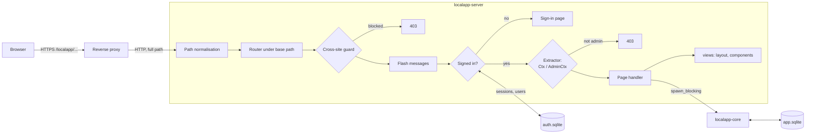

# Hockey Practice Planner

A self-hosted web app for planning hockey practices. Coaches keep a shared
library of drills, each drawn on a rink diagram, then build a practice by
dropping drills onto the ice. The finished plan downloads as a PDF with one
page per part of the practice.

Built on the LocalApp template: a Rust core library, an
[axum](https://github.com/tokio-rs/axum) server that renders HTML with
[maud](https://maud.lambda.xyz), and [htmx](https://htmx.org). Data lives in
SQLite. It ships as one binary (all assets and fonts compiled in, nothing
loaded from a CDN) inside a distroless Docker image, meant to sit behind your
reverse proxy at a path such as `https://miniserver.local/localapp`.

## Contents

- [Planning practices](#planning-practices)
- [Starting a new project](#starting-a-new-project)
- [What's included](#whats-included)
- [Layout](#layout)
- [Development](#development)
- [Configuration](#configuration)
- [Building the app](#building-the-app)
- [Security](#security)
- [Deploying](#deploying)

## Planning practices

Everything is shared: every signed-in user sees and edits the same teams,
drills and practices.

- **Teams** (`/teams`): the team name is printed in the footer of each page.
- **Drill library** (`/drills`): each drill has a name, category, suggested
  minutes, the **ice it needs**, how to run it, key teaching points (one per
  line) and equipment with quantities. Its diagram is drawn in the browser:
  players (X, O, C, G, F, D or any label), cones, pucks, puck piles, tires,
  extra nets, text, and lines for skating, skating backward, carrying the
  puck, passes, shots and crossovers, ending in an arrow, a stop or nothing.
  *Add example drills* on an empty library adds one drill of each size.
- **Practices** (`/practices`): a date, optional start time, a team, and full
  or half ice. A practice is a list of **parts**. Each part has a length, a
  title, an **ice layout**, an optional rotation time and notes. The builder
  shows each part's rink. Drag a drill from the library onto a station of the
  same size, or click a drill and then a station. Without JavaScript, pick a
  drill from the station's list instead. Parts can be reordered and copied,
  and a whole practice can be copied to a new date.
- **PDF** (*Download PDF*): one US Letter page per part. The header has the
  date, clock time (or elapsed time), part title, its length and the page
  number. The rink diagram fills the top half. A strip below it gives the
  layout, rotation, equipment for that part and its notes. The bottom half has
  each station's drill text in two columns, and the team name is in the footer.
  Text that doesn't fit is set smaller, then continues on a "(continued)" page.

### Ice sizes and layouts

The rink is a North American 200 × 85 ft sheet. A drill is drawn on the part of
the rink its size needs, and the builder moves it (mirrored or turned) onto any
slot of that size:

| Drill size | Drawn on |
|---|---|
| Full ice | the whole sheet |
| Half ice | the left half, end boards to red line |
| End zone | the left end zone, end boards to blue line |
| Neutral zone | between the blue lines |
| Quarter ice | the top-left quarter (one side of one half) |

| Layout | Stations |
|---|---|
| Full ice: one drill | full |
| Two halves | half + half |
| Three zones | end zone + neutral zone + end zone |
| Four quarters | 4 × quarter |
| Left half + two quarters / two quarters + right half | half + 2 × quarter |
| Half ice: one drill *(half-ice practices)* | half |
| Half ice split in two quarters *(half-ice practices)* | 2 × quarter |

A drill's text and diagram live in the library, so editing a drill updates
every practice that uses it. A drill in use can't be deleted or change size;
duplicate it instead.

## Starting a new project

1. Create a repository from this template (on GitHub: **Use this template**),
   or copy the folder, then clone it.
2. Rename the placeholders. Pass a kebab-case name and a display name:

   ```powershell
   ./scripts/rename.ps1 -Name recipe-box -DisplayName "Recipe Box"   # Windows
   ```

   ```sh
   ./scripts/rename.sh recipe-box "Recipe Box"                       # macOS / Linux
   ```

   This replaces `LocalApp` (display name), `LOCALAPP` (environment-variable
   prefix), `localapp_` (Rust identifiers) and `localapp` (crate, binary,
   image, URL path and compose service) everywhere.
3. Run `cargo test --workspace`, then update `README.md`, `authors` in
   `Cargo.toml`, and `LICENSE`.
4. Start the app with `./scripts/dev.ps1` (or `./scripts/dev.sh`), open the
   setup link it prints, and create the first admin.

## What's included

| Area | What you get |
|---|---|
| Accounts | Sign-in with Argon2id passwords, hashed session tokens, "keep me signed in", sign-in throttling, temporary passwords that must be changed, first-run setup link |
| Roles | `Admin` (manages users) and `User`, enforced on the server by extractors |
| Pages | Sign-in, first-run setup, a placeholder home page, *My account* (name, light/dark theme, password, sign out other devices), *Users* admin |
| Web UI | Server-rendered HTML; htmx boosts every link and form, so pages load in place with a loading bar. Toast messages, tooltips, confirmations, dark mode. Works without JavaScript |
| Storage | `auth.sqlite` for accounts, `app.sqlite` for the app's data, each with versioned migrations |
| Security | Cross-site request blocking, strict CSP and security headers, `no-store` on pages |
| Operations | `serve`, `admin create/reset-password/list` and `healthcheck` commands; a distroless non-root Docker image; compose file; Caddy/nginx/Traefik examples |
| CI | `fmt`, `clippy -D warnings` and tests on every push; image published to `ghcr.io` from `main` and `v*` tags |
| Tests | Unit tests plus HTTP integration tests that drive the whole app through a cookie-aware test client |

## Layout

```text
.
├── Cargo.toml                  workspace: shared versions, lints, profiles
├── crates/
│   ├── core/                   localapp-core: domain logic + storage, no HTTP, no users
│   │   ├── fonts/              Noto Sans (SIL OFL, see OFL.txt), embedded in PDFs
│   │   └── src/
│   │       ├── lib.rs
│   │       ├── enum_macro.rs   str_enum!: enums with a storage key and a UI label
│   │       ├── rink.rs         rink geometry + markings, ice sizes, layouts and their slots
│   │       ├── diagram.rs      a drill's drawing (JSON) and how each item and line is drawn
│   │       ├── drill.rs        drills, categories, equipment
│   │       ├── practice.rs     teams, practices, parts (segments), stations, Plan
│   │       ├── board.rs        complete SVG diagrams (one drill; a practice page)
│   │       ├── pdf.rs          the printable plan (page SVGs → PDF with krilla)
│   │       ├── samples.rs      example drills
│   │       ├── svg.rs          SVG writing helpers and print colours
│   │       └── db/             Database (app.sqlite): mod.rs, schema.rs (migrations), one file per table
│   └── server/                 localapp-server: the web app
│       ├── assets/             app.css, app.js, planner.js (builder + diagram editor), htmx.min.js, favicon.svg
│       ├── src/
│       │   ├── main.rs         serve / admin / healthcheck
│       │   ├── config.rs       LOCALAPP_* environment variables
│       │   ├── state.rs        AppState: config, auth store, app database, rate limiter
│       │   ├── extract.rs      Ctx (signed in), AdminCtx (admin)
│       │   ├── auth/           passwords, sessions, throttling, cross-site guard, store/ (auth.sqlite)
│       │   ├── routes/         practices, segments, drills, teams, home, signin, account, admin/users
│       │   ├── views/          layout, nav, components, forms
│       │   ├── flash.rs        one-shot toast messages after a redirect
│       │   ├── error.rs        AppError → HTML error page
│       │   ├── form.rs         form-value parsing helpers
│       │   ├── htmx.rs         fragment vs. boosted-page requests
│       │   └── assets.rs, cli.rs
│       └── tests/              HTTP integration tests (common/ is the harness)
├── Dockerfile, compose.yaml    container build and a compose file for the server
├── docker/                     reverse-proxy examples
├── scripts/                    rename + local dev runners
├── DEPLOY.md                   step-by-step home-server deployment
└── CLAUDE.md                   conventions for AI-assisted work on this codebase
```

### How a request flows



The server always answers with complete HTML pages and plain redirects, so
every page works without JavaScript. htmx adds, on top:

- **Boosting:** links and forms load the next page in place (`hx-boost` on `<body>`).
- **Live forms:** `views::forms::live_form` refreshes part of a page as its
  controls change (filters, previews). The server renders the whole page and
  htmx picks out the target element, so no fragment endpoints are needed.
- **Fragments:** when a control asks for only a piece of the page (one table
  row, say), the request carries `HX-Request` without `HX-Boosted`;
  `htmx::wants_fragment` detects that, and the handler returns just that piece.

## Development

Requires Rust 1.92 or newer.

```sh
cargo test --workspace                       # unit + HTTP integration tests
cargo clippy --workspace --all-targets       # CI uses -D warnings
cargo fmt --all                              # 100-column lines (rustfmt.toml)

./scripts/dev.sh                             # or ./scripts/dev.ps1 on Windows
```

`dev` runs the server at <http://127.0.0.1:8080/localapp> over plain HTTP
(secure cookies off) with its data in `./data` (git-ignored). On first start
it logs a one-time setup link for creating the admin. Extra arguments are
passed to the binary: `./scripts/dev.sh admin list`.

## Configuration

All settings are environment variables:

| Variable | Default | Meaning |
|---|---|---|
| `LOCALAPP_BASE_PATH` | *(root)* | URL prefix the app is served under, e.g. `/localapp`. The proxy must forward it unchanged. |
| `LOCALAPP_BIND` | `0.0.0.0:8080` | Address and port to listen on. |
| `LOCALAPP_DATA_DIR` | `/data` | Folder for `auth.sqlite` and `app.sqlite`. |
| `LOCALAPP_SECURE_COOKIES` | `true` | HTTPS-only cookies. Set `false` only for plain-HTTP testing. |
| `LOCALAPP_SESSION_DAYS` | `30` | Lifetime of "keep me signed in" sessions (1–365). |
| `LOCALAPP_ADMIN_USER` / `LOCALAPP_ADMIN_PASSWORD` | – | Create this admin at start-up if there is none (instead of the setup link). |
| `RUST_LOG` | `info` | Log filter, e.g. `info,tower_http=debug`. |

## Building the app

The template has no domain code: the home page is a placeholder and
`app.sqlite` holds only a `settings` table. Typical first steps:

**Add domain logic and storage (core crate).** Add types and logic to
`crates/core/src/`. For a new table, append a migration to `MIGRATIONS` in
`db/schema.rs` (never edit one that has shipped) and add `db/<table>.rs`
with an `impl Database { ... }` block, following `db/settings.rs`. Unit-test
it against `Database::in_memory()`.

**Add a page (server crate).**

1. Create `crates/server/src/routes/<page>.rs` with a `routes()` function and
   handlers. Take `Ctx` for any signed-in user, or `AdminCtx` for admins only.
2. Read and write data through `cx.db(|db| ...)`, which runs the closure on
   a blocking thread with the database locked.
3. Render with `views::page(&cx, Nav::<Page>, "Title", body)` and the
   helpers in `views::components` and `views::forms`.
4. For a change, POST a form and answer with `flash::info`, `flash::error` or
   `flash::report`: a redirect that shows a toast on the next page.
5. Merge `routes()` into `signed_in` in `routes/mod.rs`, and add a `Nav`
   variant and menu entry in `views/nav.rs`.
6. Add an integration test in `crates/server/tests/` using `common::TestApp`.

**Add a setting:** a field and `ENV_*` constant in `config.rs`, then a row in
the table above. **Add an asset:** put the file in `crates/server/assets/`
and list it in `assets.rs`.

**Different permissions:** roles are a `str_enum!` in
`auth/store/mod.rs`. To add one, add a variant there and an extractor in
`extract.rs` that checks it, the way `AdminCtx` does.

## Security

- **Passwords** are stored as Argon2id hashes. New and reset accounts get a
  random temporary password that must be changed at first sign-in.
- **Sessions** are random 256-bit tokens in `HttpOnly`, `SameSite=Lax`,
  `Secure` cookies scoped to the base path. The server stores only their
  SHA-256 hash.
- **Throttling:** after 5 wrong passwords for a username or from an address,
  each further attempt waits longer (1 s, 2 s, 4 s … up to 5 minutes). The
  error never says whether the username exists.
- **Cross-site protection:** every change must come from the app's own pages,
  checked with the browser's `Sec-Fetch-Site`/`Origin` headers on top of
  `SameSite` cookies.
- **Roles** are enforced on the server by extractors, not just hidden in the
  interface. The last active admin can't be demoted, disabled or deleted.
- **Headers:** a strict Content-Security-Policy (only the app's own scripts),
  `X-Frame-Options: DENY`, `nosniff`, and `Cache-Control: no-store` on pages.
  htmx is configured without `eval`, script execution or page snapshots in
  browser storage.
- **First admin:** the setup page needs a random token printed to the server
  log, so someone else on your network can't claim the admin account first.
- The container runs as an unprivileged user in a distroless image (no shell).

The databases are not encrypted at rest. Protect the server and its backups.

## Deploying

See [DEPLOY.md](DEPLOY.md): pulling the image from GitHub's registry, the
compose file, reverse-proxy requirements, first start, backups and updates.

## License

[MIT](LICENSE).
