# Practice Planner: user guide

Practice Planner helps you build a hockey practice one block of time at a
time, with each drill drawn on the ice, and prints one sheet per block for the
bench. This guide walks through the app with a sample practice: a warm-up,
three skill stations, and five puck-skill lanes with a goalie warm-up.

- [The idea in one minute](#the-idea-in-one-minute)
- [The drill library](#the-drill-library)
- [Making or editing a drill](#making-or-editing-a-drill)
- [Which drills fit where](#which-drills-fit-where)
- [Planning a practice](#planning-a-practice)
- [Parts and ice layouts](#parts-and-ice-layouts)
- [Putting drills on the ice](#putting-drills-on-the-ice)
- [Goalie warm-up](#goalie-warm-up)
- [Printing](#printing)
- [On a phone, and in dark mode](#on-a-phone-and-in-dark-mode)
- [Questions](#questions)

## The idea in one minute

- **Drills** live in a shared library. Each one has a diagram, instructions,
  key teaching points, and the equipment it needs. It is drawn on the piece of
  ice it needs: full ice, half ice, an end zone, the neutral zone, or one lane
  of these.
- A **practice** is a list of **parts** (for example "Warm-up, 8 min", "Skill
  stations, 24 min"). Each part splits the ice into **stations**, and each
  station runs one drill.
- The **PDF** has one page per part: the rink with every station's drill
  drawn on it, a legend, the timing and equipment, and each drill's
  instructions. One part never runs onto a second page.

Edit a drill in the library and every practice that uses it updates.

## The drill library

**Drill library** in the menu lists every drill with a thumbnail of its
diagram, the ice it needs, its category, its length and its equipment. Search
by name or text, or filter by ice size and category. On a new, empty library,
**Add example drills** adds seven to start from.

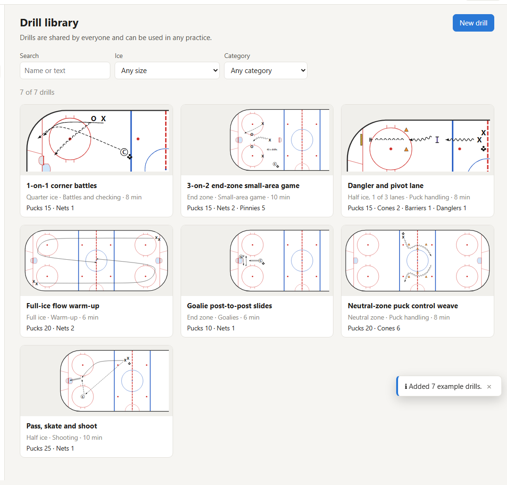

## Making or editing a drill

Click a drill to open it, or **New drill**. A drill has:

- **Name**, **Category** and **Minutes**: how long it usually runs. This is
  only a suggestion for planning; on a practice the drill gets the time of
  its part (see [Parts and ice layouts](#parts-and-ice-layouts)).
- **Ice needed**: the area it is drawn on (full ice, half ice, end zone,
  neutral zone, or neutral zone to the red line). **Width**: the whole area or
  one of 2–4 lanes running along it. "Half ice, 1 of 2 lanes" is quarter ice.
- **Diagram**: drawn on that piece of ice (see below).
- **How to run it** and **Key teaching points** (one point per line). These
  are printed under the rink.
- **Equipment**: how many pucks, cones, nets and so on. **Count equipment from
  the diagram** fills these in from what you drew.

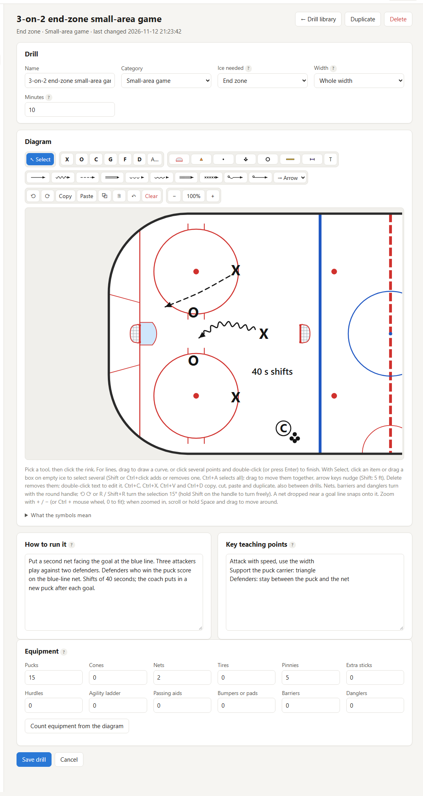

### Drawing the diagram

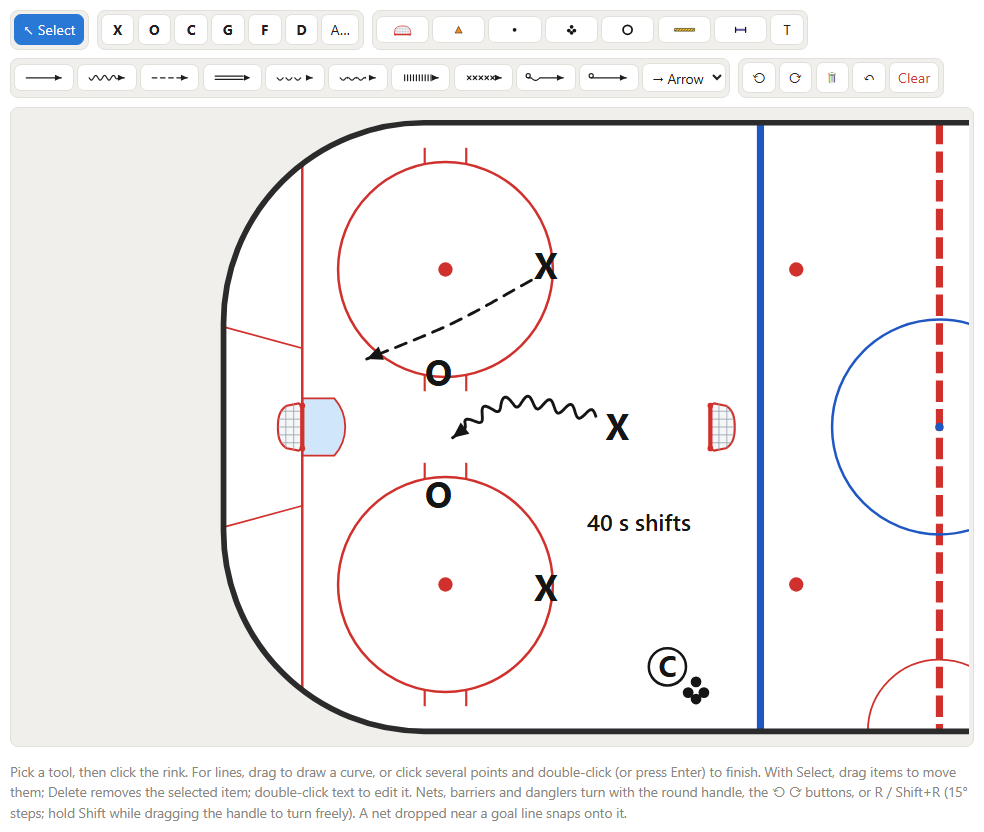

The toolbar has four groups:

1. **Select**, then players: **X**, **O**, **C** (coach), **G** (goalie),
   **F** (forward), **D** (defence) and **A…** for your own label. Numbers are
   fine too: X1, X2, C2. Coaches and goalies are drawn circled.
2. Equipment: net, cone, puck, pile of pucks, tire, barrier, dangler, and
   **T** for a text note.
3. Lines: skate, skate with puck, pass, shot, skate backward, backward with
   puck, lateral steps, crossovers, goalie pad slide, goalie butterfly slide.
   The drop-down sets how the line ends: an arrow, a stop (two bars) or
   nothing.
4. Turn left / right, **Copy**, **Paste**, duplicate (⧉), delete, undo, and
   clear.
5. Zoom: − and + (the percentage in between fits the whole ice again).

How to draw:

- Pick a tool, then click the rink to place it.
- For a line, drag to draw a curve. Or click several points and double-click
  (or press Enter) to finish.
- Double-click a text note or a player to change its label. Ctrl+Z undoes.
- Nets, barriers and danglers face a direction. Select one and drag its round
  handle to turn it (it snaps to 15°; hold Shift to turn freely), or use the
  ⟲ ⟳ buttons or R / Shift+R.
- A net dropped near a goal line snaps onto it.

### Selecting, copying and pasting

With **Select**:

- Click an item to select it, or drag a box on empty ice to select everything
  it touches. Shift+click (or Ctrl+click) adds or removes one item; Ctrl+A
  selects everything.
- Drag any selected item to move the whole selection; it stops at the edge of
  the ice. The arrow keys nudge it 1 ft (5 ft with Shift).
- **R** / **Shift+R** (or ⟲ ⟳) turn the selection 15° about its middle, for
  example a whole line of players with their skating lines.
- **Delete** removes the selection.
- **Ctrl+C**, **Ctrl+X**, **Ctrl+V** copy, cut and paste; **Ctrl+D**
  duplicates. Pasted copies land a little down and to the right, and are
  selected so you can drag them into place. You can copy from one drill, open
  another, and paste there: handy for reusing a set-up such as a net with a
  goalie and a pile of pucks.

### Zooming in

For precise work, zoom in with **+** (or Ctrl + mouse wheel, or a trackpad
pinch, which zooms towards the pointer). When zoomed in, the mouse wheel
moves around the rink, or hold **Space** (or the middle mouse button) and
drag. Press **0** or click the percentage to see the whole ice again.

The rink has no nets of its own: place the nets the drill uses, facing the way
they should.

**What the symbols mean**, under the diagram, lists every symbol. The same
symbols are used in the practice legend and on the printed page.

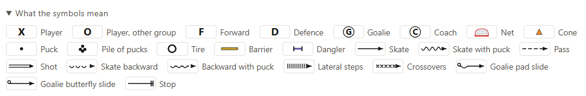

## Which drills fit where

A drill fits any station its shape fits inside, at the same place on the rink:

| Drill drawn on | Also fits |
|---|---|
| One of 4 lanes | one of 3 or 2 lanes, or the whole area |
| One of 3 lanes | one of 2 lanes, or the whole area |
| End zone (or an end-zone lane) | half ice, or a half-ice lane at least as wide |
| Half ice (or a half-ice lane) | a full-ice lane at least as wide, or full ice |
| Neutral zone to the red line | the whole neutral zone, half ice, full ice |

A neutral-zone drill doesn't fit an end, and a half-ice drill doesn't fit an
end zone: the shapes don't match the markings. A smaller drill sits against
the boards side of its station; **Flip** moves it to the other side (see
[Putting drills on the ice](#putting-drills-on-the-ice)).

## Planning a practice

**Practices → New practice**: pick the team (or type a new one), a title, the
date, an optional start time, and **Ice**: full or half. With a start time,
every part shows its clock time (5:38–6:02 PM); without one, elapsed time
(0:08–0:32).

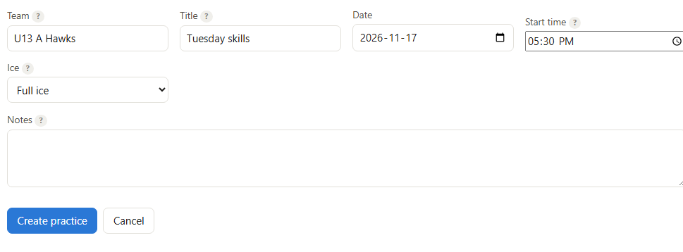

The practice page is the builder: the parts on the left, the drill library on
the right. The tiles at the top add up the length, the number of pages, and
the equipment to bring (the most any one part needs).

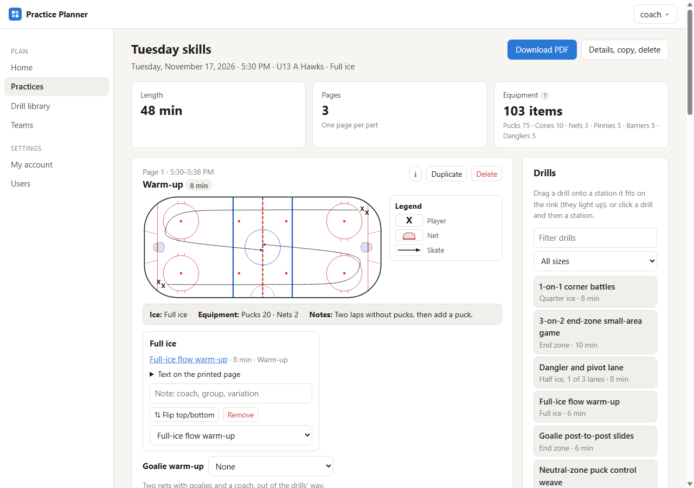

## Parts and ice layouts

Add parts with **Add a part** at the bottom: a title, minutes, and how the ice
is split.

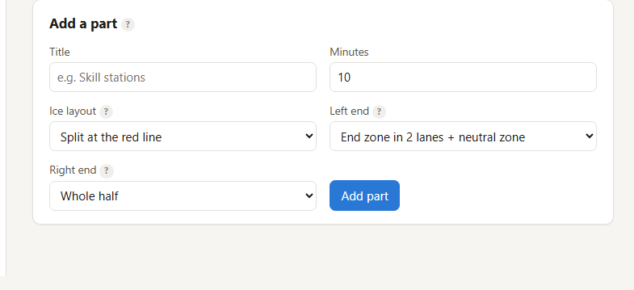

On **full ice**, **Ice layout** is one of:

- **Full ice**: one station.
- **Full ice in 2, 3 or 4 lanes**: stations running the length of the ice.
- **Split at the red line**: each end is split its own way (**Left end** and
  **Right end** appear).

Each end (or the whole sheet, on a **half-ice** practice) is one of:

- **Whole half**, or the **half in 2–4 lanes** (red line to end boards).
- **End zone + neutral zone**: the end zone is one station (or 2–4 lanes) and
  the neutral zone is its own station. When both ends do this, the neutral
  zone between the blue lines is one shared station.

So half ice holds up to five stations, and full ice up to nine. In the sample,
"Skill stations" splits both ends into end zone + neutral zone (three
stations), and "Puck skills" is three lanes on the left and two on the right.

Each part has **Part settings** to change the title, minutes, layout, a
**rotation** time (minutes per station; the strip then reads "Rotate every
8 min (3 stations, 24 min round)"), and **notes** printed on the page. If you
change the layout, drills that no longer fit are taken off. Parts can be moved
up and down with ↑ ↓, duplicated, or deleted.

On the plan, every drill in a part shows the time it actually gets there,
never its own suggested minutes: the rotation time when groups rotate between
two or more drills, otherwise the length of the part. A 10-minute drill placed
in a 3-minute part shows 3 minutes.

## Putting drills on the ice

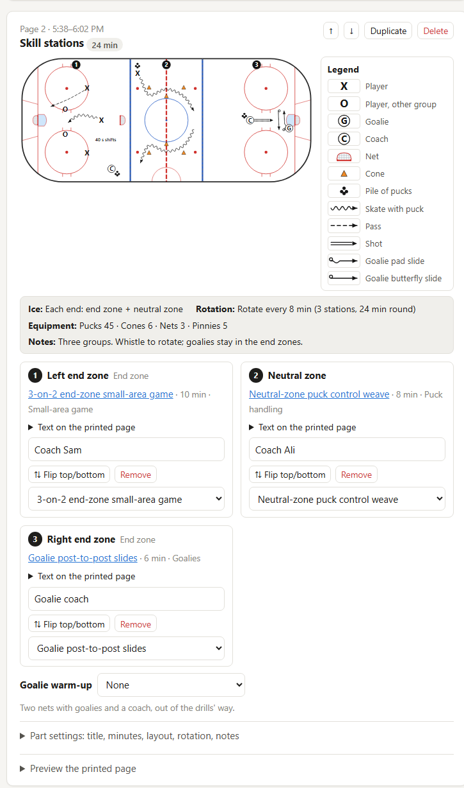

Each part shows its rink with its drills, a legend of the symbols they use, a
strip with the layout, rotation, equipment and notes, and a card for each
station. When a part has two or more drills they are numbered 1, 2, 3… on the
rink, on the station cards and on the printed page. Only zones with a drill
get a number, counted in order, so leaving a zone empty doesn't leave a gap.
On the printed page an empty zone is simply blank. There are three ways to
place a drill:

- **Drag** it from the library onto the rink.
- **Click** it in the library, then click a station.
- **Pick** it from the station's list. It is placed as soon as you pick it.

When you drag or click a drill, the stations it fits light up. Here a
quarter-ice drill was picked: both right-hand lanes are wide enough, the three
narrower left-hand lanes are not.

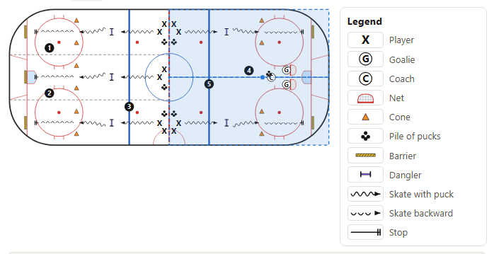

Each station card shows the drill, its printed text (**Text on the printed
page**), a note, and its controls:

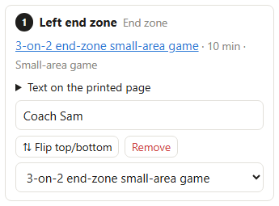

- **Note**: for example the coach running it, a group, or a variation. It
  saves when you leave the box and is printed with the drill.
- **⇅ Flip top/bottom**: turns the drill over inside its station. Use it when
  a drill should run along the other boards, or through open ice instead of
  along the boards. A drill in a bottom lane is already mirrored so it stays
  on the boards; flip it if you want it the other way. Placing a different
  drill in the station clears the flip.
- **Remove** takes the drill off. The list below picks another one.

Changes update the part in place, without reloading the page or losing your
place.

## Goalie warm-up

When none of a part's drills need the goalies, they can warm up on the side:
two nets with a goalie in each and a coach shooting. Under the stations,
choose a spot for **Goalie warm-up**: a corner at either end, or along the
boards in the neutral zone.

It is compact (about 19 × 17 ft), so it fits in a corner or a gap between
stations. Drag it on the rink to wherever it is out of the way, and turn it so
the nets face the right way:

- drag the round blue handle just past the coach (it turns in 15° steps; hold
  Shift to turn freely);
- or press **R** (Shift+R the other way) while you're dragging it;
- or use the ⟲ ⟳ buttons (45° at a time).

Its two nets are added to the equipment, and it appears on the printed page.

In "Puck skills" the lanes on the right run along the boards, so the warm-up
sits in the open strip between them, facing the end boards:

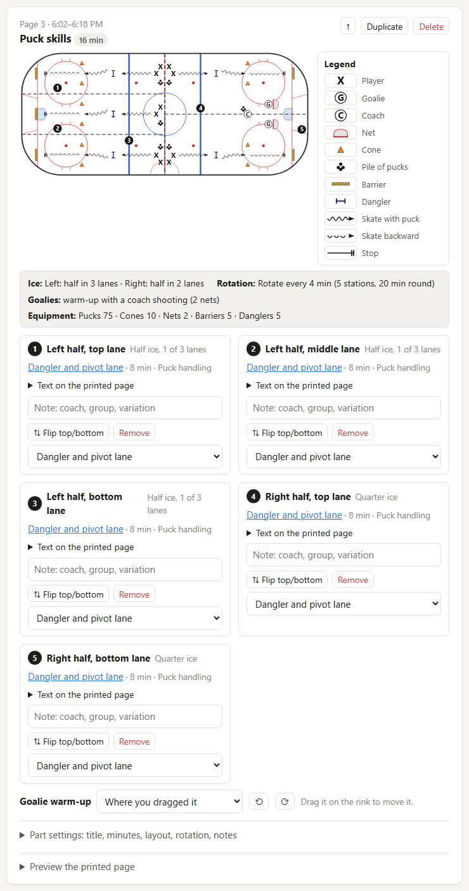

## Printing

**Download PDF** at the top of a practice gives one US Letter page per part.
To check a single page first, open **Preview the printed page** at the bottom
of a part. It shows that page exactly as it prints, and it updates as you
make changes.

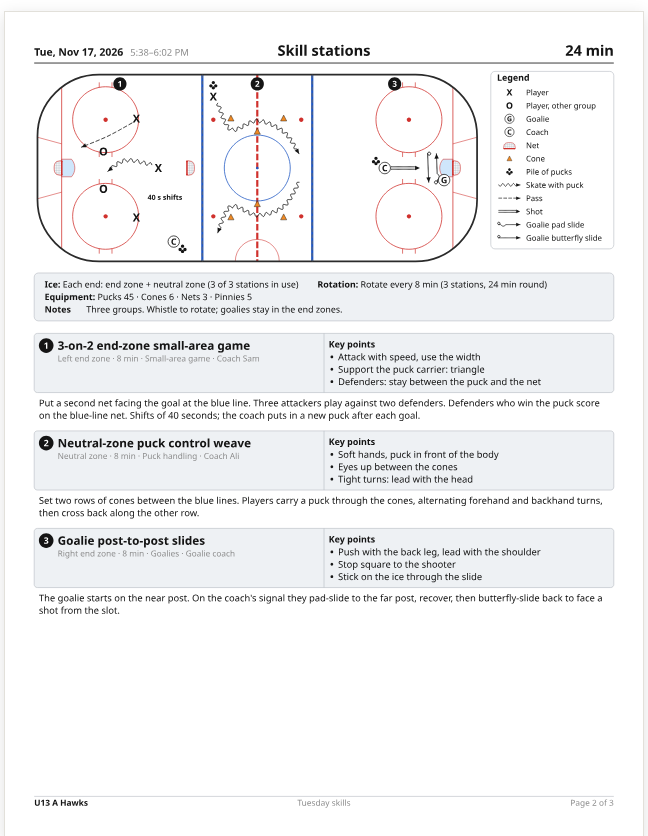

Each page has:

- a one-line **header**: date, time of that part, part title and length;
- the **rink** with every station's drill, numbered, and the **legend** of the
  symbols used;
- the **strip**: layout, rotation, goalie warm-up, equipment and notes;
- one block per **drill**, kept together: a title bar with the station number,
  name, zone, minutes, category and note on the left and the key points on the
  right, then how to run it underneath;
- a one-line **footer**: team, practice title and page number.

A part always fits on one page. When there is a lot of text, the rink gets
smaller, and then the text gets smaller. Only when even
that isn't enough is the text cut short, with a note at the bottom. If that
happens, shorten the instructions in the library, or split the part in two.

## On a phone, and in dark mode

The app works on a phone: the library moves below the parts and the legend
below the rink. It follows your device's light or dark setting (or choose one
under **My account**). The printed page always stays white.

| Dark mode | Phone |
|---|---|
| 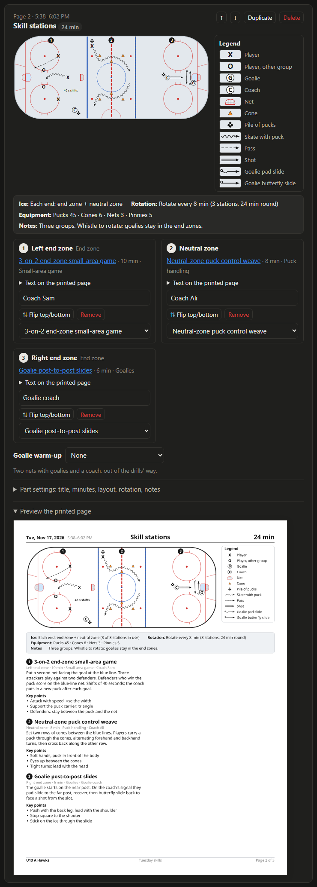 | 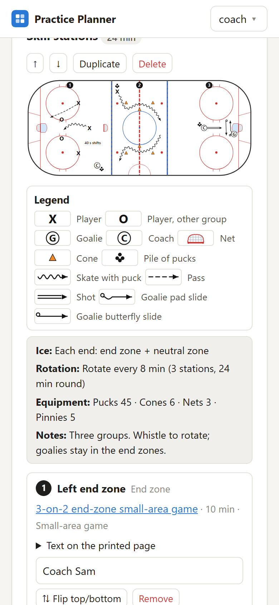 |

## Questions

**Why can't I delete a drill or change its size?**
It is used in a practice. Remove it from those practices first, or
**Duplicate** it and change the copy.

**I changed a practice from full ice to half ice and my parts were reset.**
Full-ice layouts don't exist on half ice (and the other way round), so every
part goes back to the default layout and loses its drills and goalie warm-up.
The titles, minutes and notes are kept. Copy the practice first if you want
to keep the original.

**Can I reuse last week's practice?**
Yes: **Details, copy, delete → Copy** makes a copy with a new date, with all
its parts, drills, notes, flips and goalie warm-ups.

**Where does the team name come from?**
**Teams** in the menu. It is printed in the footer of every page.

**It works without JavaScript?**
Yes. Everything works with plain forms: pick drills from the station lists,
choose goalie spots from the list, and edit diagrams as text. Dragging and
drawing need JavaScript.
