# Practice Planner: user guide

Practice Planner helps you build a hockey practice one block of time at a
time, with each drill drawn on the ice, and prints one sheet per block for the
bench. This guide walks through the app with a sample practice: a warm-up,
three skill stations, and five puck-skill lanes with a goalie warm-up.

- [The idea in one minute](#the-idea-in-one-minute)
- [Teams and coaches](#teams-and-coaches)
- [The drill library](#the-drill-library)
- [Making or editing a drill](#making-or-editing-a-drill)
- [Which drills fit where](#which-drills-fit-where)
- [Planning a practice](#planning-a-practice)
- [Parts and ice layouts](#parts-and-ice-layouts)
- [Putting drills on the ice](#putting-drills-on-the-ice)
- [Goalie warm-up](#goalie-warm-up)
- [Development focus](#development-focus)
- [Printing](#printing)
- [On a phone, and in dark mode](#on-a-phone-and-in-dark-mode)
- [Questions](#questions)

## The idea in one minute

- **Teams**: you plan practices together with the other coaches of your team.
- **Drills** live in libraries: your own, and one for each of your teams.
  Each one has a diagram, instructions,
  key teaching points, and the equipment it needs. It is drawn on the piece of
  ice it needs: full ice, half ice, an end zone, the neutral zone, or one lane
  of these.
- A **practice** is a list of **parts** (for example "Warm-up, 8 min", "Skill
  stations, 24 min"). Each part splits the ice into **stations**, and each
  station runs one drill.
- Each drill says how its time splits across **Hockey Canada's development
  levels**, and the app compares every practice (and the season) with the
  targets for the team's age division.
- The **PDF** has one page per part: the rink with every station's drill
  drawn on it, a legend, the timing and equipment, and each drill's
  instructions. One part never runs onto a second page.

Edit a team drill and every one of the team's practices that uses it updates.

## Teams and coaches

**Teams** in the menu lists the teams you're in. **Add a team** creates one
with you as its **owner**. Give it an **age division** (U7 to U18) so the
app can compare its practices with Hockey Canada's targets. On a team's page, owners add the other coaches by
their username (an admin creates accounts), and make each one an **owner** or
a **coach**:

- Everyone in the team sees its practices, plans and prints them, and edits
  the team's drills.
- Owners also rename or delete the team and decide who's in it.

You only ever see your own teams. **Leave team** takes you out; the team keeps
its practices and drills. A team always keeps an owner, so the last owner
has to make someone else an owner before leaving.

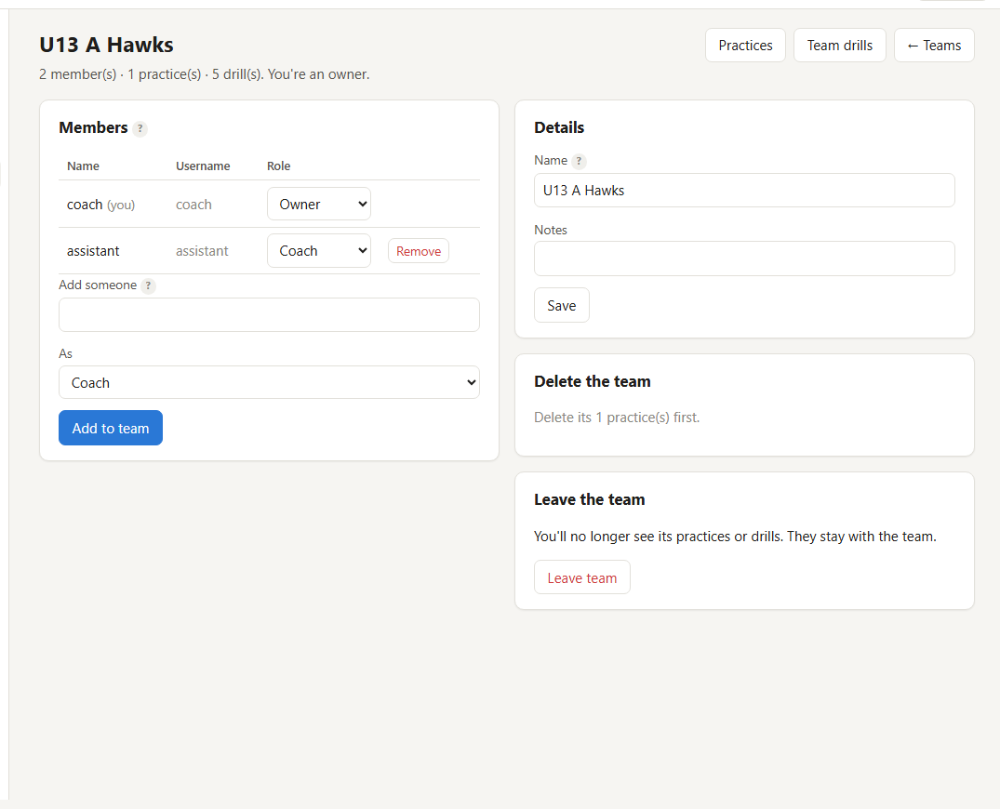

## The drill library

**Drill library** in the menu shows one library at a time; pick which at the
top:

- **My drills**: your own. Only you see them.
- **<team> (team)**: the team's drills, shared by everyone in the team. The
  team's practices use these.

Each drill shows a thumbnail of its diagram, the ice it needs, its category,
its length and its equipment. Search by name or text, or filter by ice size
and category. In an empty library, **Add example drills** adds seven to
start from.

On a drill's page, **Copy to** puts a copy in another of your libraries: a
team drill into your own to make your version of it, or one of yours into a
team. A copy is separate from then on: changing one never changes the other.
So nobody else can change your drills, and you can't change theirs; you can
always copy one and change the copy.

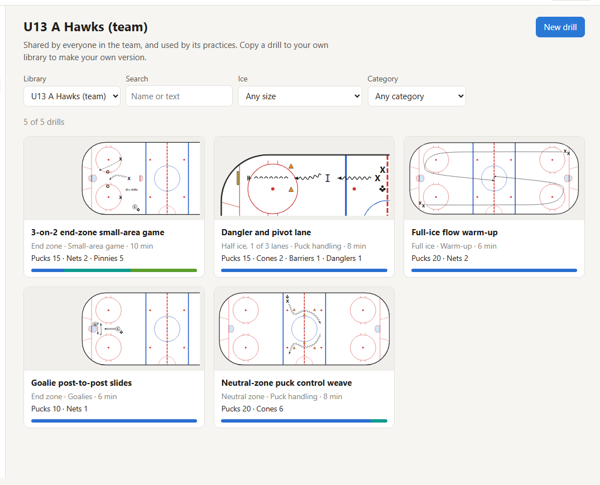

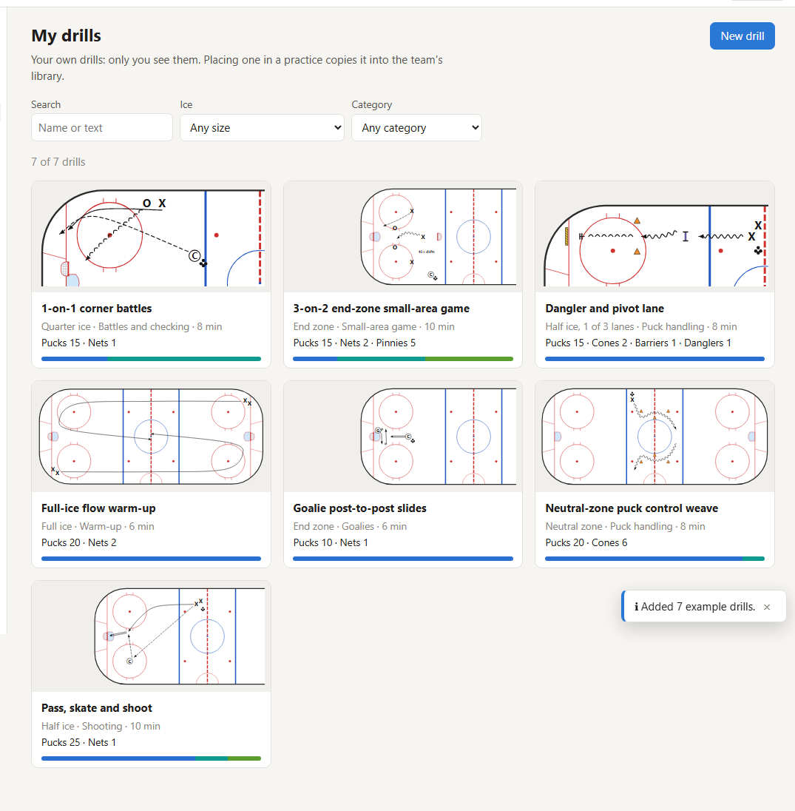

## Making or editing a drill

Click a drill to open it, or **New drill**. A drill has:

- **Name**, **Category** and **Minutes**: how long it usually runs. This is
  only a suggestion for planning; on a practice the drill gets the time of
  its part (see [Parts and ice layouts](#parts-and-ice-layouts)).
- **Ice needed**: the area it is drawn on (full ice, half ice, end zone,
  neutral zone, or neutral zone to the red line). **Width**: the whole area or
  one of 2–4 lanes running along it. "Half ice, 1 of 2 lanes" is quarter ice.
- **Diagram**: drawn on that piece of ice (see below).
- **How to run it** and **Key teaching points** (one point per line). These
  are printed under the rink.
- **Equipment**: how many pucks, cones, nets and so on. **Count equipment from
  the diagram** fills these in from what you drew.
- **Development**: how the drill's time splits across the five development
  levels (technical skills, individual tactics, team tactics, team play,
  strategy), in 5% steps adding up to 100%. Required: a drill can't be saved
  without it. A 2-on-1 drill might be 40 / 30 / 30 / 0 / 0. See
  [Development focus](#development-focus).

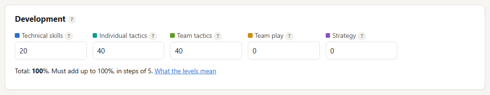

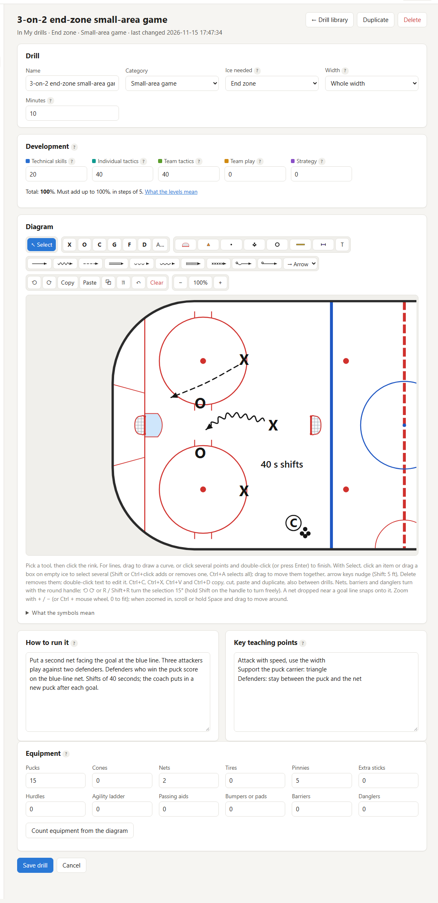

### Drawing the diagram

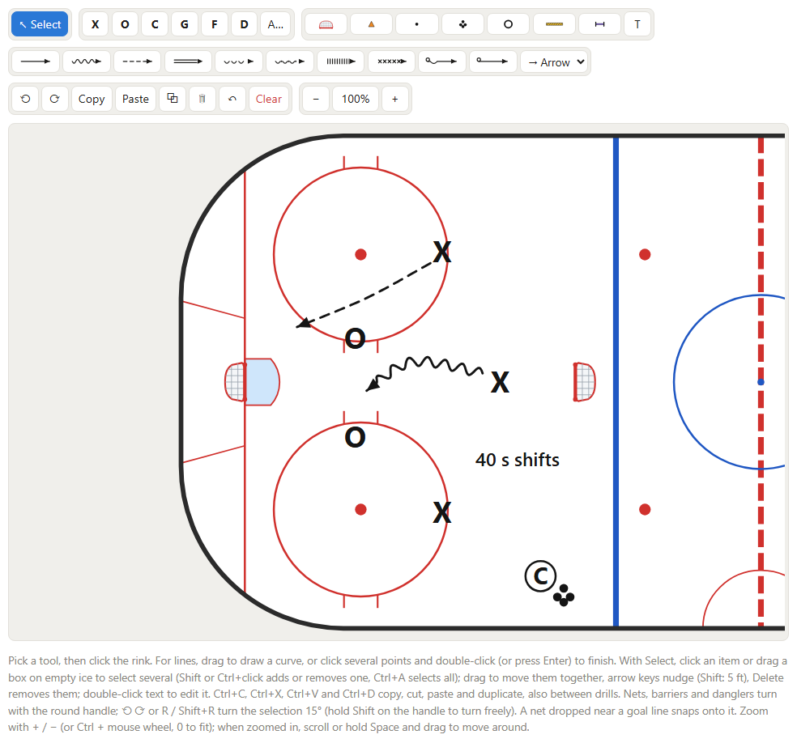

The toolbar has four groups:

1. **Select**, then players: **X**, **O**, **C** (coach), **G** (goalie),
   **F** (forward), **D** (defence) and **A…** for your own label. Numbers are
   fine too: X1, X2, C2. Coaches and goalies are drawn circled.
2. Equipment: net, cone, puck, pile of pucks, tire, barrier, dangler, and
   **T** for a text note.
3. Lines: skate, skate with puck, pass, shot, skate backward, backward with
   puck, lateral steps, crossovers, goalie pad slide, goalie butterfly slide.
   The drop-down sets how the line ends: an arrow, a stop (two bars) or
   nothing.
4. Turn left / right, **Copy**, **Paste**, duplicate (⧉), delete, undo, and
   clear.
5. Zoom: − and + (the percentage in between fits the whole ice again).

How to draw:

- Pick a tool, then click the rink to place it.
- For a line, drag to draw a curve. Or click several points and double-click
  (or press Enter) to finish.
- Double-click a text note or a player to change its label. Ctrl+Z undoes.
- Nets, barriers and danglers face a direction. Select one and drag its round
  handle to turn it (it snaps to 15°; hold Shift to turn freely), or use the
  ⟲ ⟳ buttons or R / Shift+R.
- A net dropped near a goal line snaps onto it.

### Selecting, copying and pasting

With **Select**:

- Click an item to select it, or drag a box on empty ice to select everything
  it touches. Shift+click (or Ctrl+click) adds or removes one item; Ctrl+A
  selects everything.
- Drag any selected item to move the whole selection; it stops at the edge of
  the ice. The arrow keys nudge it 1 ft (5 ft with Shift).
- **R** / **Shift+R** (or ⟲ ⟳) turn the selection 15° about its middle, for
  example a whole line of players with their skating lines.
- **Delete** removes the selection.
- **Ctrl+C**, **Ctrl+X**, **Ctrl+V** copy, cut and paste; **Ctrl+D**
  duplicates. Pasted copies land a little down and to the right, and are
  selected so you can drag them into place. You can copy from one drill, open
  another, and paste there: handy for reusing a set-up such as a net with a
  goalie and a pile of pucks.

### Zooming in

For precise work, zoom in with **+** (or Ctrl + mouse wheel, or a trackpad
pinch, which zooms towards the pointer). When zoomed in, the mouse wheel
moves around the rink, or hold **Space** (or the middle mouse button) and
drag. Press **0** or click the percentage to see the whole ice again.

The rink has no nets of its own: place the nets the drill uses, facing the way
they should.

**What the symbols mean**, under the diagram, lists every symbol. The same
symbols are used in the practice legend and on the printed page.

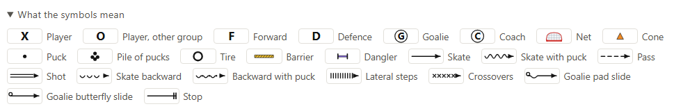

## Which drills fit where

A drill fits any station its shape fits inside, at the same place on the rink:

| Drill drawn on | Also fits |
|---|---|
| One of 4 lanes | one of 3 or 2 lanes, or the whole area |
| One of 3 lanes | one of 2 lanes, or the whole area |
| End zone (or an end-zone lane) | half ice, or a half-ice lane at least as wide |
| Half ice (or a half-ice lane) | a full-ice lane at least as wide, or full ice |
| Neutral zone to the red line | the whole neutral zone, half ice, full ice |

A neutral-zone drill doesn't fit an end, and a half-ice drill doesn't fit an
end zone: the shapes don't match the markings. A smaller drill sits against
the boards side of its station; **Flip** moves it to the other side (see
[Putting drills on the ice](#putting-drills-on-the-ice)).

## Planning a practice

**Practices → New practice**: pick the team (or type a new one), a title, the
date, an optional start time, and **Ice**: full or half. With a start time,
every part shows its clock time (5:38–6:02 PM); without one, elapsed time
(0:08–0:32).

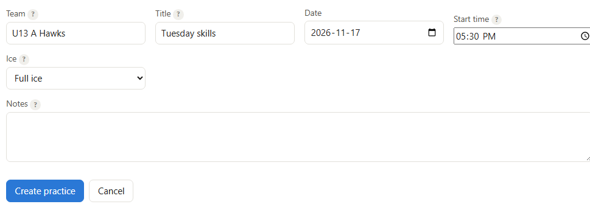

The practice page is the builder. At the top: the length, the number of
pages, the equipment to bring (the most any one part needs), the
**Development focus** panel and the **timeline**. Below them are two columns:
the **Practice plan** card with the parts on the left, and the drill library
on the right. On a wide screen both stay in view as you scroll: the parts
scroll inside their card while the pointer is over them, and the library
scrolls inside its own box.

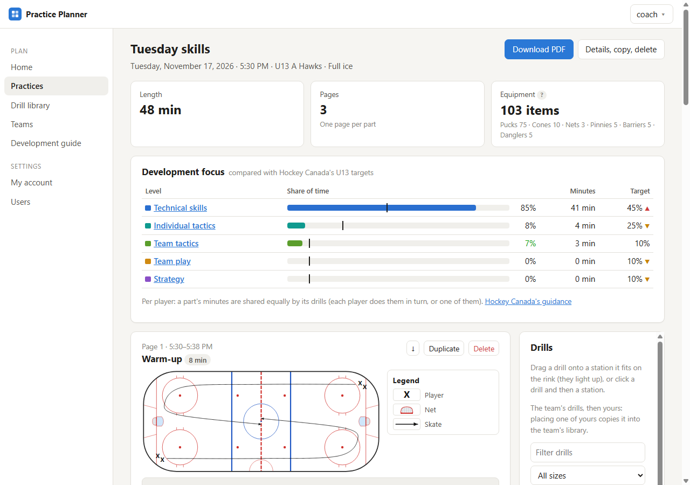

- **The library** is a scroll box of drill cards: name, a small diagram, the
  coloured development bar, category and the ice it needs. The team's drills
  come first, then your own (marked "yours"). Placing one of yours copies it
  into the team's library, so everyone in the team sees it and later changes
  to your own drill don't change the practice. Filter by name, size, category
  or main level. **Closer to the targets** shows only the drills that would
  bring this practice nearer the team's development targets, best first.
  "used ×2" means the drill is already in the practice twice. Hover over a
  card for a larger diagram and its key points.
- **✎** on a card opens the drill editor. Saving (or **Back to the
  practice**) brings you back where you were.
- **The divider** between the columns can be dragged to give the parts or the
  library more room (or focused and moved with the arrow keys; double-click it
  for half and half). Each side keeps enough room to stay readable, and the
  library shows two or three cards across.
- **The timeline** has a block for each part, as wide as its minutes and
  coloured by the level it spends most time on. Click a block to jump to that
  part; drag blocks to reorder the parts.
- **Overview** shrinks every part to its title and rink, side by side, to see
  the whole practice at once. Click it again for the full cards.
- Once you scroll past the summary, a slim bar stays at the top with the
  length and each level's share (▲ ▼ when off target).

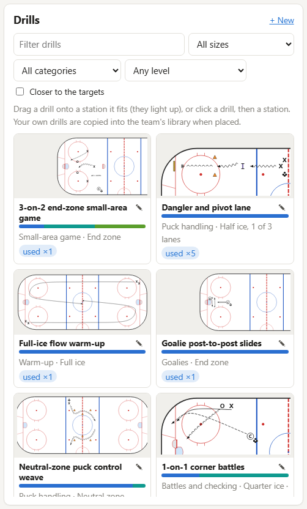

On a narrower screen the library is a drawer: **Drills** opens it, and
picking a drill closes it so you can tap a station. Under **My account →
Practice builder** you can turn off any of these extras you don't use: the
development panel, the timeline, the bar on each part, the summary bar, the
"fits" counts and the hover preview.

### Undo and history

Every change to the parts (adding, moving, renaming, placing or removing a
drill, notes, the goalie warm-up) can be undone, at any time and by anyone in
the team. **↶ Undo** above the parts takes back the latest one. **History**
lists the recent changes, newest first, with who made them; **Go back to
before this** puts the practice back as it was before that change. Going
back is itself a change, so it can be undone too.

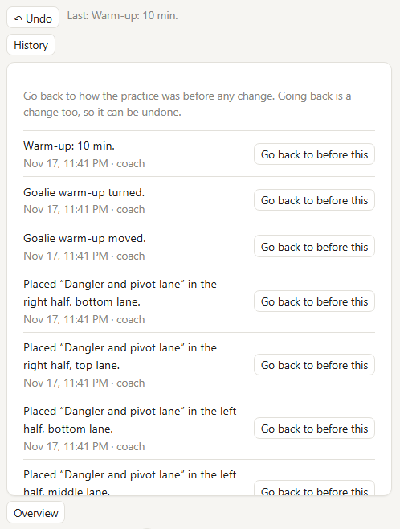

## Parts and ice layouts

Each part is a card. Add one with the **+** between the cards (or at the
start or the end): a small form asks for a title, minutes and how the ice is
split, and the part goes exactly there.

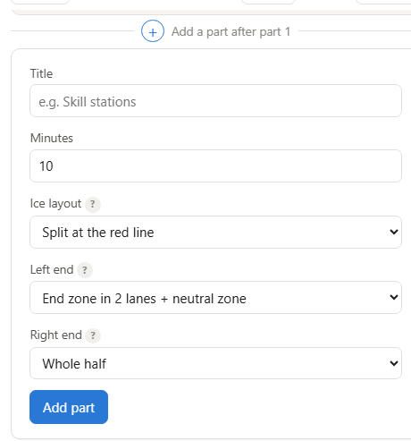

On **full ice**, **Ice layout** is one of:

- **Full ice**: one station.
- **Full ice in 2, 3 or 4 lanes**: stations running the length of the ice.
- **Split at the red line**: each end is split its own way (**Left end** and
  **Right end** appear).

Each end (or the whole sheet, on a **half-ice** practice) is one of:

- **Whole half**, or the **half in 2–4 lanes** (red line to end boards).
- **End zone + neutral zone**: the end zone is one station (or 2–4 lanes) and
  the neutral zone is its own station. When both ends do this, the neutral
  zone between the blue lines is one shared station.

So half ice holds up to five stations, and full ice up to nine. In the sample,
"Skill stations" splits both ends into end zone + neutral zone (three
stations), and "Puck skills" is three lanes on the left and two on the right.

A part's card has four tabs:

- **Rink**: the rink with its drills, where you drop drills; under it the
  legend and the strip (layout, rotation, equipment and notes).
- **Stations**: a card for each station (see below) and the goalie warm-up.
- **Settings**: title, minutes, layout, a **rotation** time (minutes per
  station; the strip then reads "Rotate every 8 min (3 stations, 24 min
  round)"), and **notes** printed on the page. If you change the layout,
  drills that no longer fit are taken off.
- **Page**: the printed page, exactly as it prints.

The title and minutes can also be changed right in the card's header: click
them, type, and press Enter (or click elsewhere). Drag a card by its **⠿**
grip to move it (or use ↑ ↓); **Duplicate** and **Delete** are beside them.
The bar under the title shows that part's development split.

On the plan, every drill in a part shows the time it actually gets there,
never its own suggested minutes: the rotation time when groups rotate between
two or more drills, otherwise the length of the part. A 10-minute drill placed
in a 3-minute part shows 3 minutes.

## Putting drills on the ice

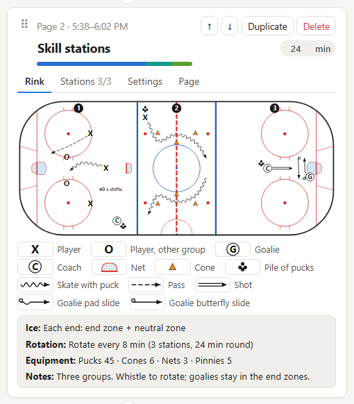

When a part has two or more drills they are numbered 1, 2, 3… on the
rink, on the station cards and on the printed page. Only zones with a drill
get a number, counted in order, so leaving a zone empty doesn't leave a gap.
On the printed page an empty zone is simply blank. There are three ways to
place a drill:

- **Drag** it from the library onto the rink.
- **Click** it in the library, then click a station.
- **Pick** it from the station's list on the **Stations** tab. It is placed
  as soon as you pick it.

When you drag or click a drill, the stations it fits light up, and each
part's header says how many empty stations it fits ("fits 2 empty"); parts
where it fits nowhere are dimmed. Here a
quarter-ice drill was picked: both right-hand lanes are wide enough, the three
narrower left-hand lanes are not.

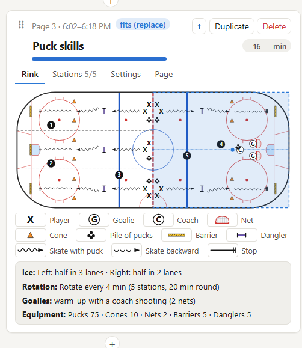

On the **Stations** tab, each station card shows the drill, its printed text
(**Text on the printed page**), a note, and its controls:

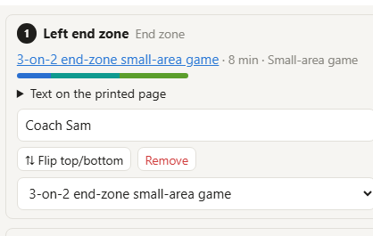

- **Note**: for example the coach running it, a group, or a variation. It
  saves when you leave the box and is printed with the drill.
- **⇅ Flip top/bottom**: turns the drill over inside its station. Use it when
  a drill should run along the other boards, or through open ice instead of
  along the boards. A drill in a bottom lane is already mirrored so it stays
  on the boards; flip it if you want it the other way. Placing a different
  drill in the station clears the flip.
- **Remove** takes the drill off. The list below picks another one.

Changes update the part in place, without reloading the page or losing your
place.

## Goalie warm-up

When none of a part's drills need the goalies, they can warm up on the side:
two nets with a goalie in each (or one net and one goalie) and a coach
shooting. On the **Stations** tab, under the stations, choose a spot for
**Goalie warm-up**: a corner at either end, or along the boards in the neutral
zone.

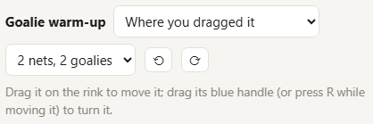

It is compact (about 19 × 17 ft), so it fits in a corner or a gap between
stations. Drag it on the rink to wherever it is out of the way, and turn it so
the nets face the right way:

- drag the round blue handle just past the coach (it turns in 15° steps; hold
  Shift to turn freely);
- or press **R** (Shift+R the other way) while you're dragging it;
- or use the ⟲ ⟳ buttons (45° at a time).

With only one goalie, choose **1 net, 1 goalie** in the box next to the spot:
the warm-up shrinks to a single net facing the coach. It stays where it is, and
moving it or picking another spot keeps it at one net.

Its nets are added to the equipment, and it appears on the printed page.

In "Puck skills" the lanes on the right run along the boards, so the warm-up
sits in the open strip between them, facing the end boards:

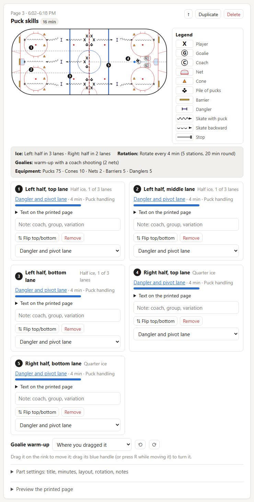

## Development focus

Hockey Canada recommends how much practice time players should spend at each
level of its development pyramid, by age: at U7 almost all of it on technical
skills, at U13 and older more on tactics, team play and strategy.
**Development guide** in the menu explains the levels, lists the targets for
every division, and links to Hockey Canada's documents.

On a practice, the **Development focus** panel under the summary shows the
share of time at each level, per player, against the team's targets. A black
mark on each bar is the target; ▲ means above it and ▼ below it by more than
5 points. It updates as you place and remove drills.

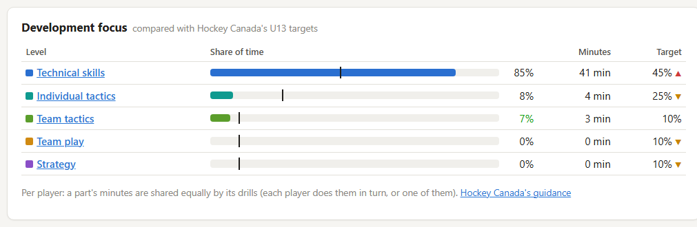

How the time is counted: a part's minutes are shared equally by its drills.
With a rotation, each player does every station in turn; without one, each
group spends the part at one station, so on average it comes to the same.
Parts without drills don't count, and nor do drills whose split hasn't been
set (the panel says how many minutes those are).

One practice can lean one way; it's the season that should balance out. The
team's page adds up all its practices so far (and, below, the planned ones
too). Owners set the team's age division there under **Age division and
targets**, and can enter the team's own targets instead of Hockey Canada's
if their association asks for something different.

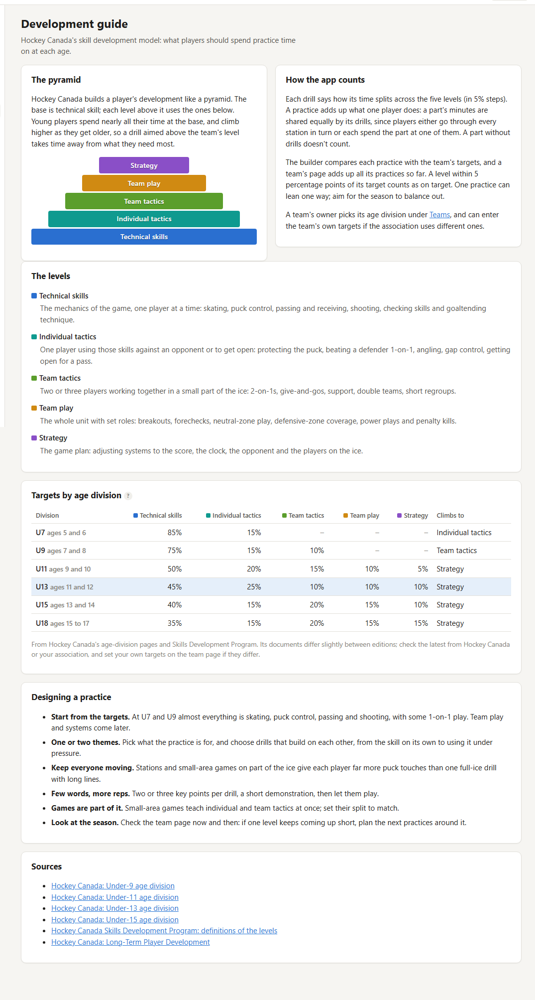

## Printing

**Download PDF** at the top of a practice gives one US Letter page per part.
To check a single page first, open the part's **Page** tab. It shows that
page exactly as it prints, and it updates as you make changes.

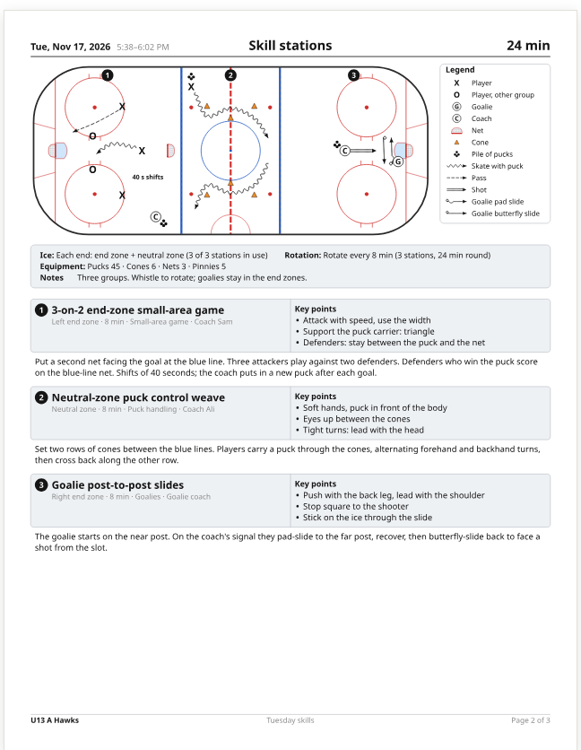

Each page has:

- a one-line **header**: date, time of that part, part title and length;
- the **rink** with every station's drill, numbered, and the **legend** of the
  symbols used;
- the **strip**: layout, rotation, goalie warm-up, equipment and notes;
- one block per **drill**, kept together: a title bar with the station number,
  name, zone, minutes, category and note on the left and the key points on the
  right, then how to run it underneath;
- a one-line **footer**: team, practice title and page number.

A part always fits on one page. When there is a lot of text, the rink gets
smaller, and then the text gets smaller. Only when even
that isn't enough is the text cut short, with a note at the bottom. If that
happens, shorten the instructions in the library, or split the part in two.

## On a phone, and in dark mode

The app works on a phone: the parts take the whole width and the library
opens as a drawer with **Drills**. It follows your device's light or dark
setting (or choose one under **My account**). The printed page always stays white.

| Dark mode | Phone |
|---|---|
| 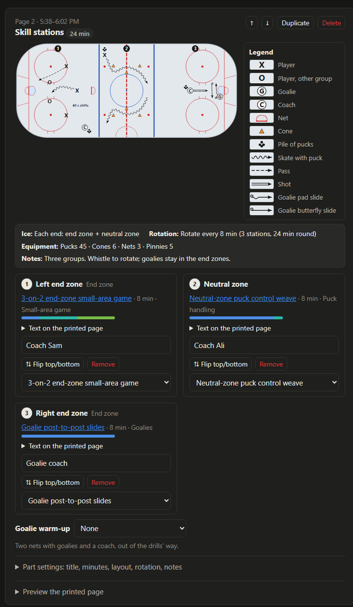 | 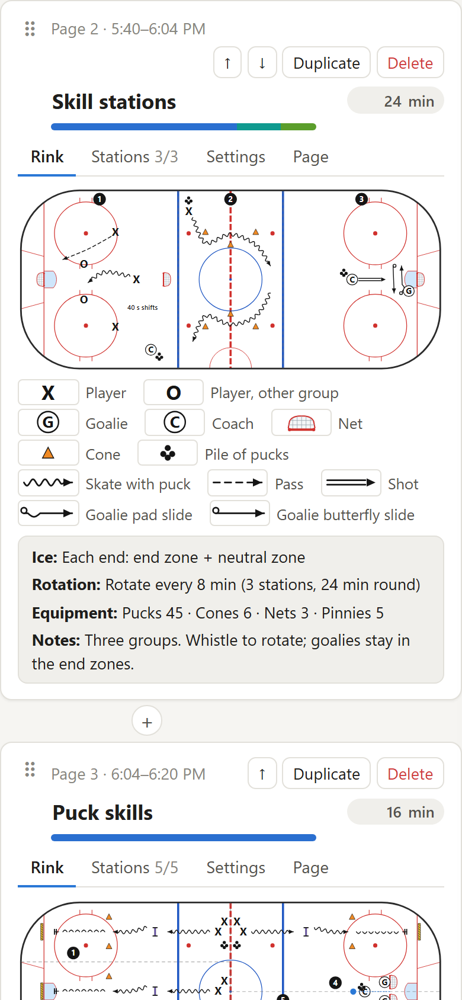 |

## Questions

**Why can't I delete a drill or change its size?**
It is used in one of the team's practices. Remove it from those practices
first, or **Duplicate** it and change the copy.

**I placed my drill in a practice, then changed my drill. Why didn't the
practice change?**
Placing it copied it into the team's library, and the practice uses that
copy. Change the team's copy (open it from the station), or copy yours into
the team again and place the new copy.

**Why don't my drills count on the Development focus panel?**
Drills made before the development model don't have a split yet. Open each
one, fill in **Development** and save; the library marks them "Development
split not set".

**A coach can't see our practices.**
They need to be in the team: an owner adds them on the team's page, by the
username the admin gave them.

**I changed a practice from full ice to half ice and my parts were reset.**
Full-ice layouts don't exist on half ice (and the other way round), so every
part goes back to the default layout and loses its drills and goalie warm-up.
The titles, minutes and notes are kept. Copy the practice first if you want
to keep the original.

**Can I reuse last week's practice?**
Yes: **Details, copy, delete → Copy** makes a copy with a new date, with all
its parts, drills, notes, flips and goalie warm-ups.

**Where does the team name come from?**
**Teams** in the menu (owners can rename it). It is printed in the footer of
every page.

**It works without JavaScript?**
Yes. Everything works with plain forms: pick drills from the station lists,
choose goalie spots from the list, and edit diagrams as text. Dragging and
drawing need JavaScript.
